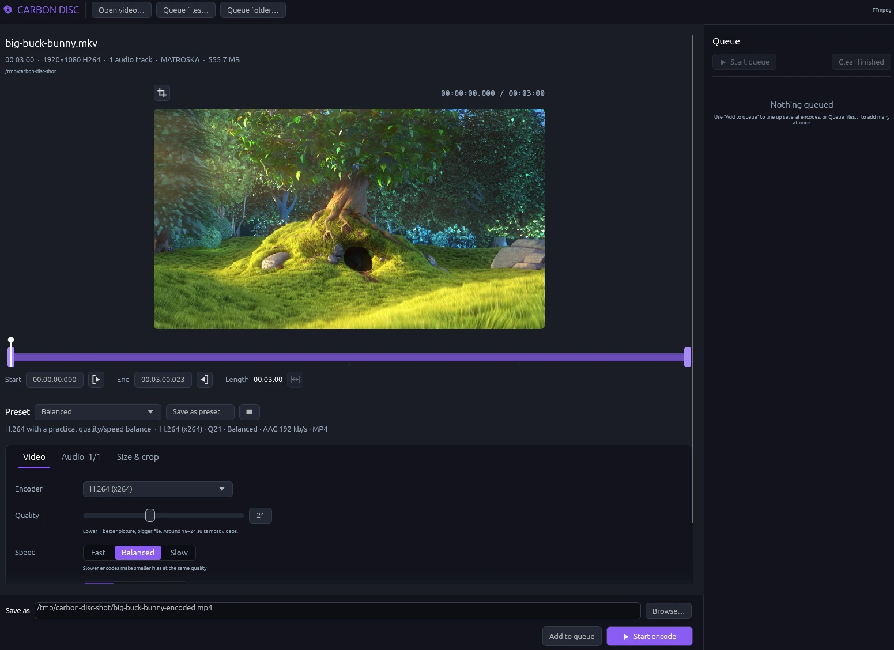
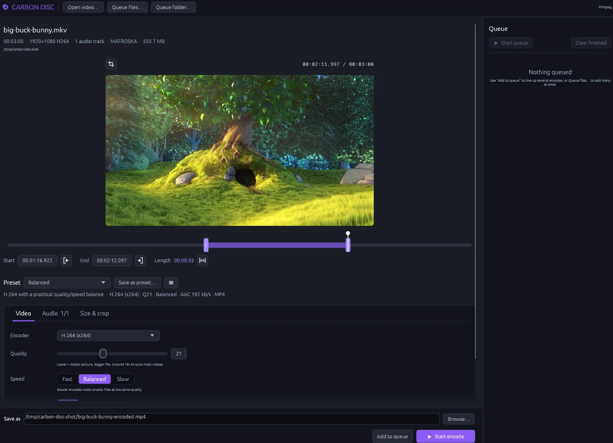
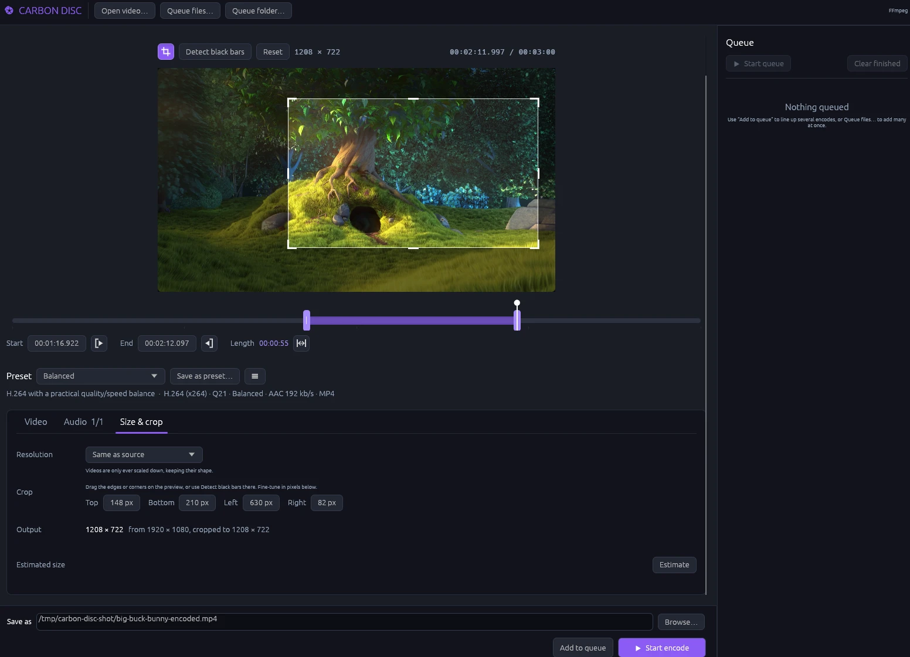
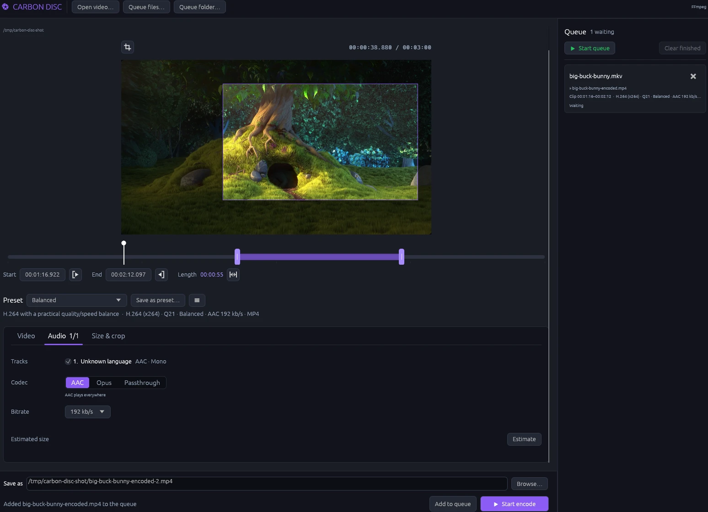

# Carbon Disc

Carbon Disc is an open-source desktop video transcoder written in Rust and powered by
FFmpeg. It aims for HandBrake's approachable workflow while keeping the media backend
behind a small, testable Rust interface.

> Early development: probing, frame previews, start/end range cutting, audio-track
> selection, crop and resolution controls, pre-encode size estimates, safe output
> replacement, hardware encoder discovery, custom presets, recursive batch import,
> persistent queues, progress, cancellation, and FFmpeg transcoding are implemented.
> Subtitles and filters are planned next.

## Screenshots

<p>
  
  
  <br>
  
  
</p>

The sample video is [Big Buck Bunny](https://peach.blender.org/), © Copyright
Blender Foundation, licensed CC-BY 3.0.

## Architecture

The dependency direction is deliberately one-way:

```text
gui ──commands──> queue/coordinator ──requests──> MediaEngine trait
                                                   │
                                                   └── FfmpegEngine adapter
model <──────────────── shared domain values ───────────────┘
```

- `model` owns backend-neutral media metadata and encode requests.
- `engine::MediaEngine` is the application/backend contract.
- `engine::ffmpeg` is the only module that knows FFmpeg/FFprobe arguments and output.
- `queue` owns background work and publishes immutable UI snapshots through events.
- `persistence` owns versioned JSON documents for custom presets and unfinished jobs.
- `gui` follows edirstat's native egui layout and dark slate/violet visual language.

This process boundary is intentional. It avoids unsafe libav FFI, isolates GPL tooling,
makes cancellation reliable, and allows a future libav or remote worker adapter without
rewriting the app.

## Install

Prebuilt downloads for Linux, Windows, and macOS are on the
[releases](https://github.com/peculiarnewbie/carbon-disc/releases) page. The
**slim** builds are small and do not include FFmpeg — the app shows per-platform
install instructions on first launch — while the full builds bundle FFmpeg and
need nothing else. The macOS build is x86_64 (it runs on Apple Silicon through
Rosetta) and is not code-signed, so right-click → Open it the first time.

## Requirements

Building from source needs:

- Rust 1.85 or newer
- `ffmpeg` and `ffprobe` on `PATH`

Release bundles ship the tools beside the app binary, which Carbon Disc finds
automatically. Override the tools when developing against a custom build:

```bash
export CARBON_DISC_FFMPEG=/path/to/ffmpeg
export CARBON_DISC_FFPROBE=/path/to/ffprobe
cargo run
```

The local `/home/bolt/git/other/HandBrake` checkout is HandBrake source, not an FFmpeg
checkout. It is useful as a product/behavior reference, but is not linked into Carbon Disc.

## Run

```bash
cargo run --release
cargo run -- --probe /path/to/video.mkv
cargo run -- --capabilities
cargo test
```

The capabilities command performs a one-frame initialization check before reporting a
hardware encoder, avoiding devices that are compiled into FFmpeg but unusable on the
current machine. The GUI performs the same discovery in the background and limits its
encoder menu accordingly.

Custom presets and unfinished queue entries are saved as versioned JSON in the platform's
local application-data directory. Restored jobs never assume overwrite permission: a
missing source or existing destination is shown as a failed job that needs attention.
Batch files and folders use the active encode settings, select the first audio track, and
write a sibling `<source>-encoded.<container>` destination.

## License

MIT. Carbon Disc runs FFmpeg as a separate process and never links it, so the
app itself carries no FFmpeg license obligations — but if you distribute a
build that bundles an FFmpeg binary, that binary is still governed by its own
license and build configuration.
